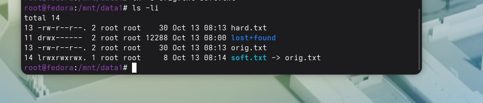
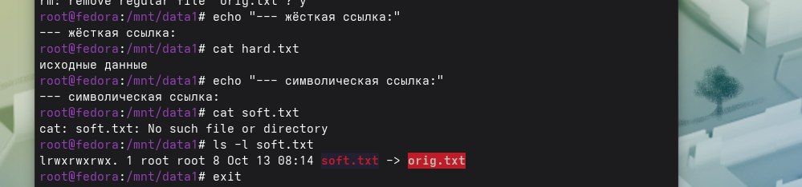

ls -li до удаления(посмотреть на иноды). 
. 
cat hard.txt и cat soft.txt после удаления оригинала:  
.  
Вопрос 1)Потому что жесткая ссылка это новое имя того же inode, а символическая отдельный файл, содержащий путь к другому имени.При удалении оригинального файла в случае с жесткой ссылкой, ядро просто уменьшает счетчик inode с 2 на 1.Счетчик ненулевой и данные не удаляются с диска.В случае с символической ссылкой файл открывается и не может найти оригинал,на который ссылвется.  

Вопрос 2)Так как inode уникален только в пределе одной ФС,в другой он может быть занят чем-то другим.Поэтому ядро при ссылке на него идет проверять таблицу inode только этого раздела и никакого другого.
