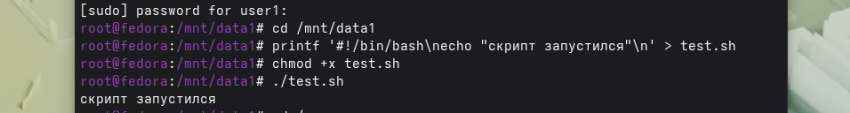
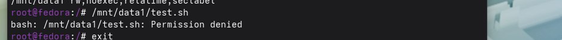

Вывод test.sh до перемонтирования.  
.  
Вывод после:  
.  
Вопрос 1) При попытке запуска файла произошла бы ошибка, так как noexec запрещает ядру запускать на выполнение программы и имеет приоритет выше chmod +x.  

Вопрос 2) nosuid - заставляет ядро игнорировать биты SUID и SGID для всех файлов(если в программе они есть,и владелец root то его права получит на время ее выполнения любой запустивший).Угроза: Если злоумышленник сможет записать в /tmp свой файл,то он сможет загрузить туда программу для повышения привилегий или запустить ее, чтобы стать root.
nodev - запрещает ядру интерпретировать специальные файлы устройств на этой файловой системе,рассматривая файл как файл,а не как устройство,даже если он так выглядит.Угроза:Злоумышленник может создать файл устройства, указывающий на физический диск и попытаться читать или записывать данные на диск.
Нужно защититься, поэтому их и испозьзуют.

