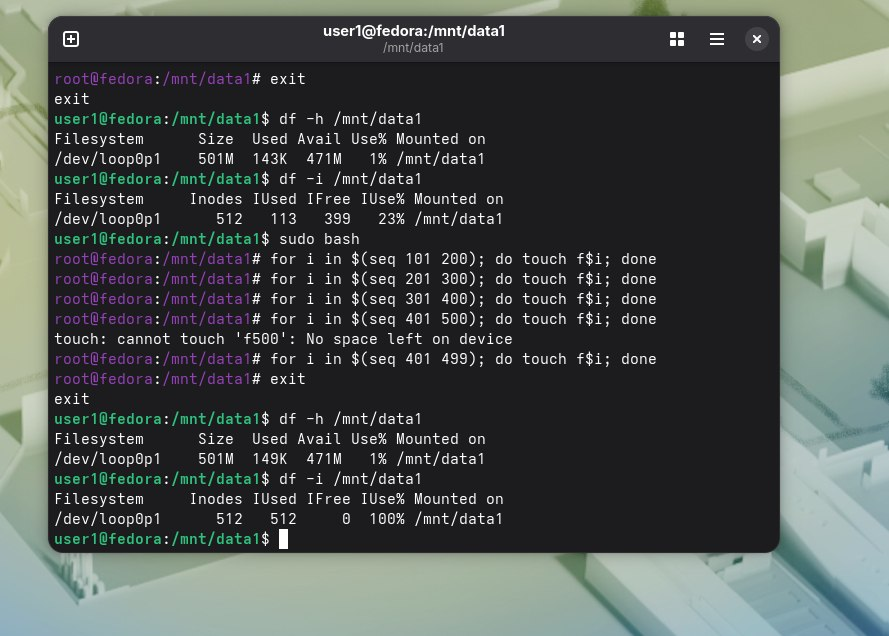

Занятое место:  
. 

Вопрос 1) Система отказала на 499 файле.  

Вопрос 2) Потому что закончились иноды - структуры, в которых хранятся метаданные файлов.  

Вопрос 3) Приимер: Каждый пользователь при заходе на сайт создает файл сессии,сам по себе крошечный, но занимает инод.
