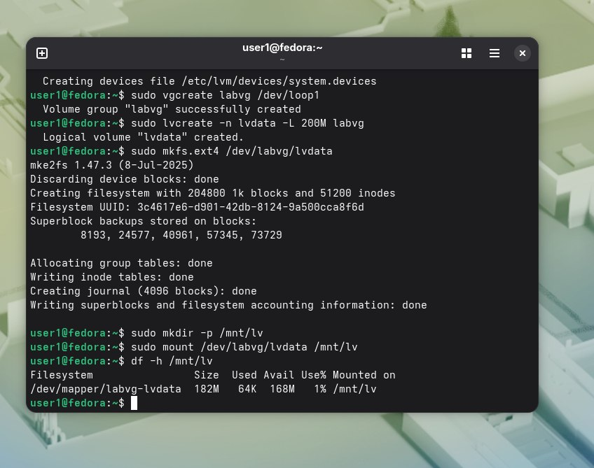
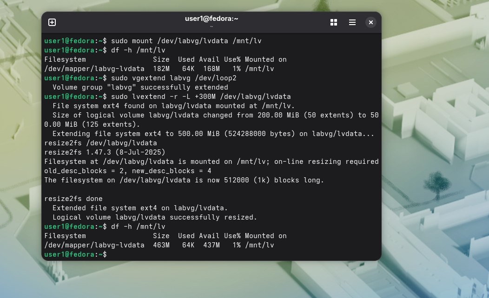

До расширения:  
. 
После:  
. 

Вопрос 1) pvcreate - инициализирует физический диск или раздел
vgcreate - создает группу томов, объединяя в нее несколько
lvcreate - нарезает куски из группы томов и создвет логические тома
vgextend - добавляет физический том в группу
lvextend - увеличивает размер существующего логического тома,забирая место из группы томов.  

Вопрос 2)Чтобы автоматически расширить файловую систему сразу после увеличения самого логического тома.  

Вопрос 3) Потому что можно изменять размер без простоя ФС,делать снапшот или миграцию данных без остановки БД
