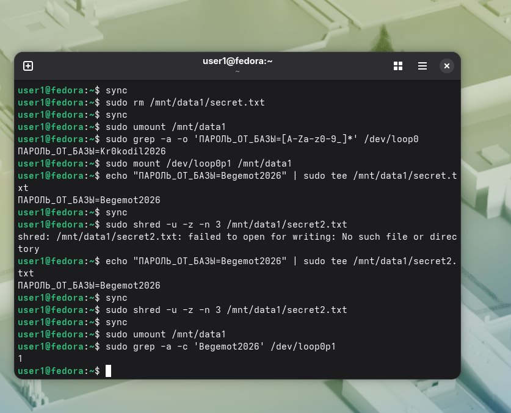

Первый и второй пароли:  
. 

Вопрос 1)rm - удаляет запись в каталоге и помечает блоки данных как свободные

shred - перезаписывает блоки случайными данными. 

Вопрос 2)Потому что shred работает на уровне логических адресов, которые видит операционная система, а SSD-контроллер внутри работает на уровне физических блоков и постоянно их перемещает. Из-за этого shred не может гарантированно затереть именно те физические ячейки, где реально лежали данные.

Вопрос 3) Shred,так как rm не поможет.SSD  изначально шифровать.Можно физически уничтожить.
